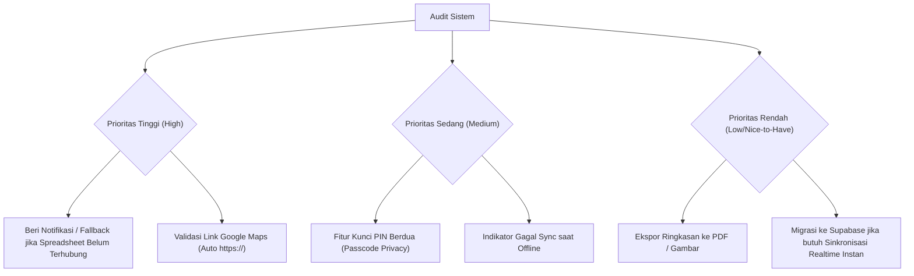

# 📋 Rangkuman Evaluasi: Analisis Bug, Batasan, dan Kekurangan Sistem

Dokumen ini memuat audit teknis secara menyeluruh terhadap sistem aplikasi **List Date & Trip Kota**, mencakup arsitektur data, sinkronisasi cloud, antarmuka pengguna (UI/UX), keamanan, serta rekomendasi solusi pengembangan ke depannya.

---

## 1. 🗄️ Aspek Penyimpanan & Sinkronisasi Data (Data Persistence)

| # | Temuan / Kekurangan | Detail Dampak | Rekomendasi Solusi |
|---|---|---|---|
| **1.1** | **Hilangnya Data saat Reload jika Belum Terhubung ke Spreadsheet** | Karena penyimpanan `localStorage` dinonaktifkan sesuai permintaan, data saat ini berjalan di memori (*In-Memory RAM*). Jika pengguna belum mengaitkan Google Spreadsheet, data yang baru dibuat akan kembali ke data awal saat halaman di-*refresh*. | Aktifkan kembali penyimpanan *hybrid* atau berikan peringatan banner: *"Spreadsheet belum terhubung, data akan hilang saat tab ditutup"*. |
| **1.2** | **Latensi Jaringan Google Apps Script (Cold Start)** | Google Apps Script gratis memiliki jeda waktu *cold-start* (sekitar 1,5 – 3 detik) untuk memproses permintaan tulis (*POST*). Meski UI sudah memakai teknik *Optimistic Update* (instan di layar), sinkronisasi ke baris spreadsheet memerlukan waktu beberapa detik di latar belakang. | Menggunakan caching cerdas atau beralih ke database modern seperti **Supabase / Firebase Firestore** jika ingin sinkronisasi sub-detik (*realtime websocket*). |
| **1.3** | **Bug Multi-Akun Google saat Deploy Script (`authuser=X`)** | Pengguna yang login dengan lebih dari satu akun Google di browser yang sama sering mengalami pesan error: *"Maaf, saat ini tidak dapat membuka file"* akibat benturan sesi akun pada Google Drive. | Membuka editor Apps Script melalui **Incognito Window** atau menggunakan layanan *no-code* pihak ketiga (misal: SheetDB). |
| **1.4** | **Potensi Race Condition (Konkurensi)** | Jika kamu dan pasangan mengedit atau menambahkan destinasi pada detik yang bersamaan, request terakhir berpotensi menimpa baris spreadsheet (*Last-Write-Wins*). | Menerapkan penguncian baris (*LockService* di Google Apps Script) atau ID berbasis timestamp milidetik presisi. |

---

## 2. 🛡️ Aspek Keamanan & Aksesibilitas (Security & Privacy)

| # | Temuan / Kekurangan | Detail Dampak | Rekomendasi Solusi |
|---|---|---|---|
| **2.1** | **Tidak Adanya Sistem Autentikasi / PIN Berdua** | Aplikasi dapat diakses oleh siapa saja yang memiliki tautan web (misal di Vercel). Siapa pun yang membuka web bisa melihat rencana kencan kalian. Begitu pula URL Google Apps Script yang disetel *"Anyone"* secara teknis dapat menerima request jika URL-nya bocor. | Menambahkan fitur **PIN Rahasia Berdua (Passcode 4–6 Digit)** di halaman pembuka web sebelum masuk ke dashboard. |
| **2.2** | **Formula Injection pada Google Sheets (CSV/Sheet Injection)** | Jika input teks (nama tempat/lokasi) diawali karakter simbol formula matematika seperti `=`, `+`, `-`, atau `@`, Google Sheets dapat mengevaluasi teks tersebut sebagai formula rumus. | Melakukan *sanitasi* input di `Code.gs` dengan menambahkan tanda petik satu (`'`) di depan karakter simbol matematika. |

---

## 3. 🖥️ Aspek UI / UX & Fungsionalitas Aplikasi

| # | Temuan / Kekurangan | Detail Dampak | Rekomendasi Solusi |
|---|---|---|---|
| **3.1** | **Validasi Format Tautan Google Maps** | Jika pengguna memasukkan teks biasa tanpa awalan protokol (`https://`), tautan tombol *"Maps"* dapat dianggap sebagai URL relatif lokal dan gagal membuka aplikasi peta. | Menambahkan auto-prepend `https://` atau validasi regex sederhana pada field input link Google Maps. |
| **3.2** | **Penanganan Mode Offline (Koneksi Putus)** | Jika pengguna menambah data di tengah kondisi sinyal internet mati/putus, aksi simpan ke Google Sheets di background akan gagal secara diam-diam (*silent fail*), sehingga data hanya ada di memori dan tidak masuk ke spreadsheet. | Menambahkan indikator status jaringan (*Online/Offline indicator*) dan antrean sinkronisasi (*retry queue*). |
| **3.3** | **Format Jam Antar Perangkat (12-Jam vs 24-Jam)** | Input HTML `<input type="time" />` bergantung pada pengaturan jam lokal perangkat pengguna (ada yang format AM/PM dan ada yang 24 Jam), sehingga tampilan urutan jam di itinerary bisa sedikit berbeda formatnya di iOS/Android. | Melakukan normalisasi format jam ke format 24 jam standar (`HH:mm`) sebelum disimpan. |
| **3.4** | **Belum Tersedianya Fitur Export / Backup Cadangan** | Pengguna belum memiliki tombol satu-klik untuk mendownload seluruh data kencan ke dalam format file `PDF` atau `JSON` sebagai cadangan kenang-kenangan. | Menambahkan tombol *"Ekspor Data / Unduh PDF Rencana Trip"*. |

---

## 4. 📈 Matriks Prioritas Perbaikan (Roadmap Rekomendasi)

---

## 5. Kesimpulan Teknis

Secara keseluruhan, sistem telah berjalan dengan sangat baik untuk kebutuhan fungsional inti:
- ✅ Desain estetik, modern, user-friendly, dan responsif.
- ✅ Dukungan 3 kategori (Bulanan, Jangka Panjang + Tabungan, dan Rencana Kota + Itinerary jam).
- ✅ Real-time Optimistic UI tanpa reload.
- ✅ Terhubung ke Google Spreadsheet resmi.

Kelemahan terbesar saat ini terletak pada **ketergantungan penyimpanan ke Google Sheets** karena `localStorage` dinonaktifkan: jika koneksi internet terputus atau Google Sheets belum disetel, data yang diinput di browser bersifat sementara (*ephemeral*).

